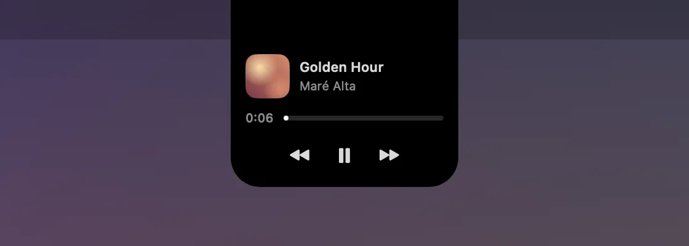
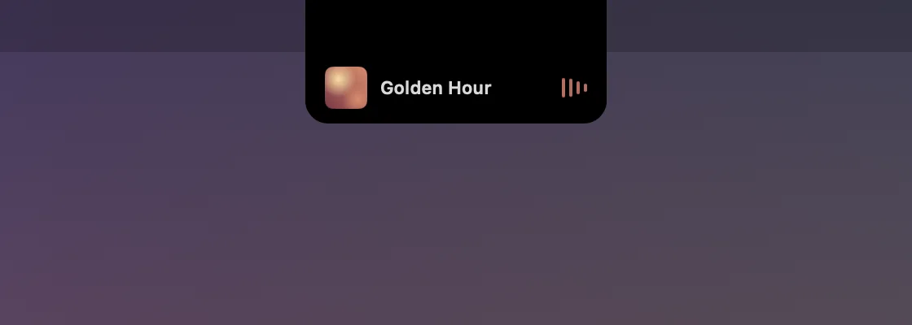
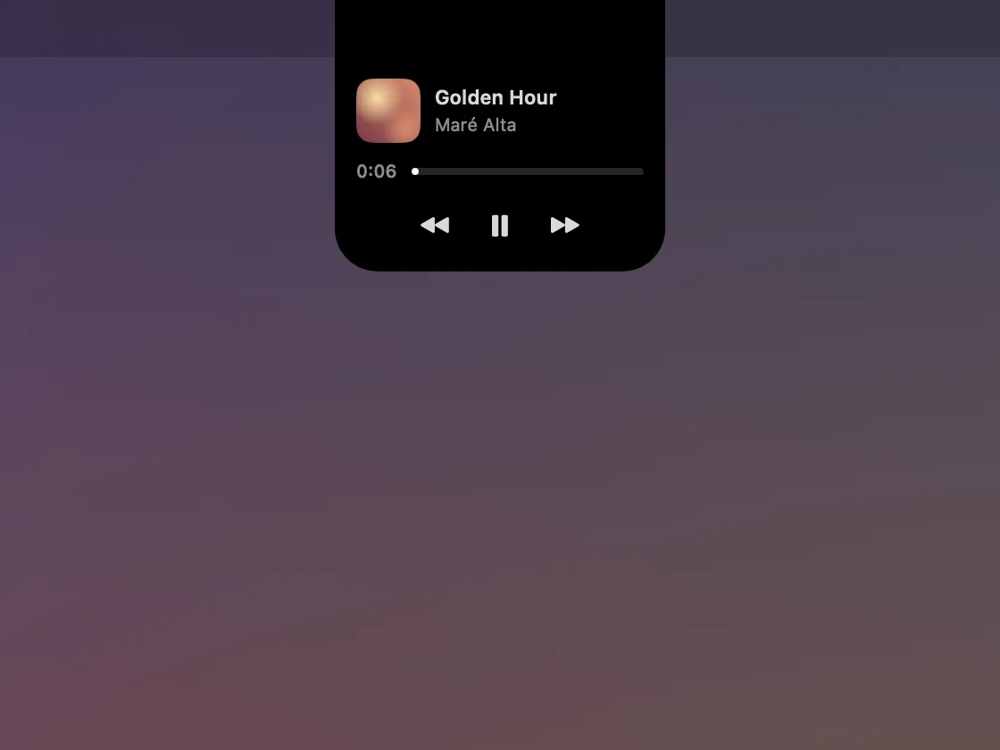
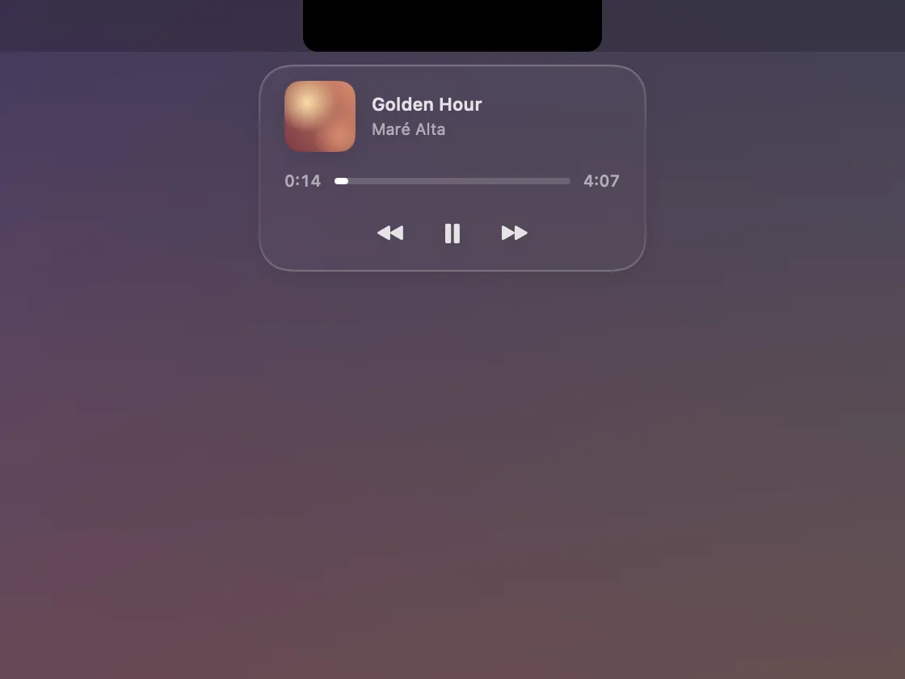
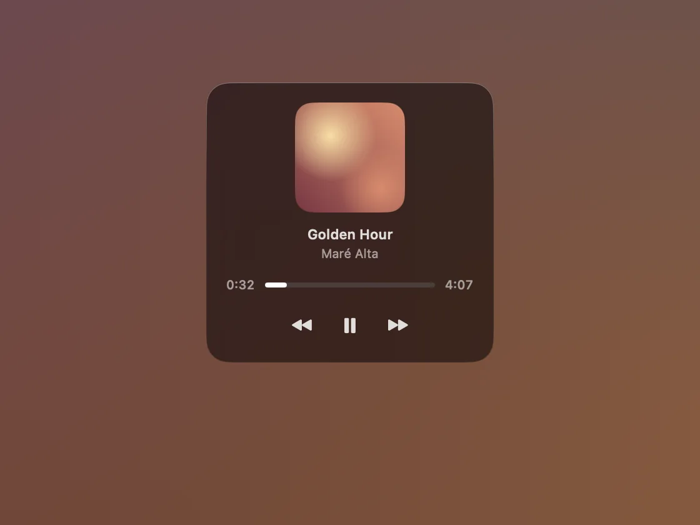
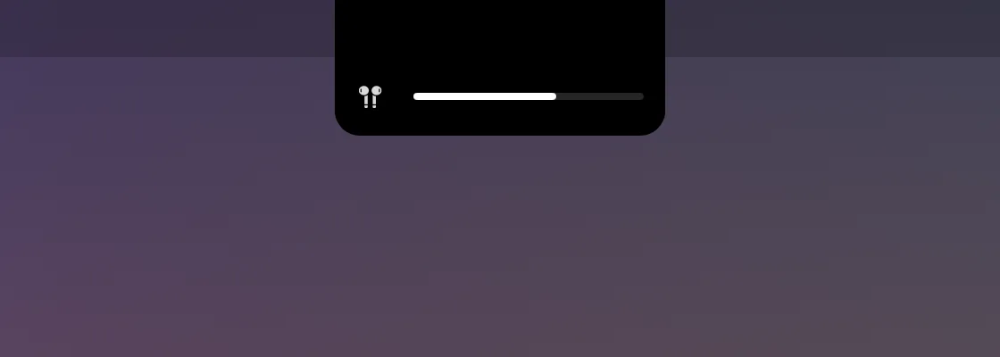
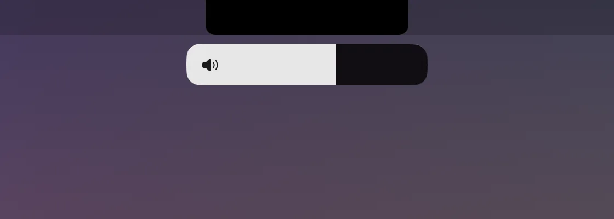
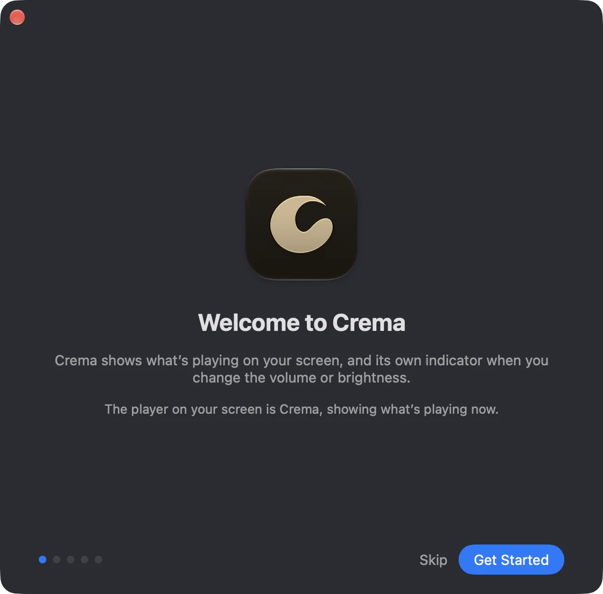
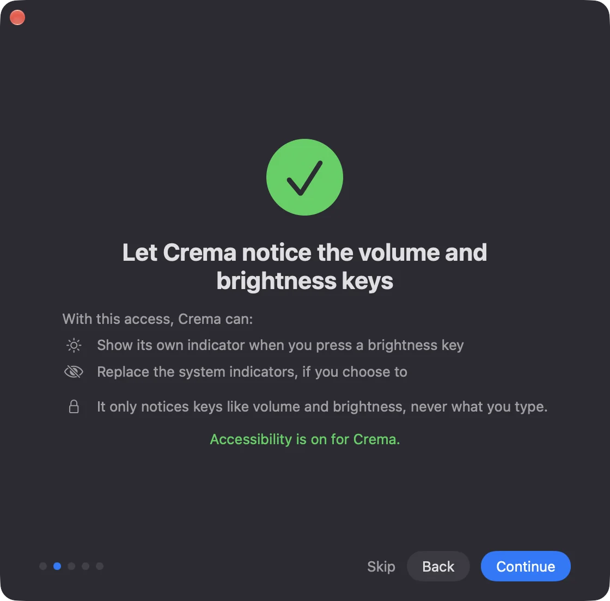

<!-- The bold tagline and the subtitle below it are final (author's pick).
     Every picture is a capture of the real app from docs/assets/site/, taken by
     scripts/site-capture/capture.sh; rerun it rather than editing an image. -->

<p align="center">
  
</p>

<h1 align="center">Crema</h1>

<p align="center"><strong>A quiet companion for your Mac's notch. Native and out of the way.</strong></p>

<p align="center">
It shows what's playing: album art, a touch of its color, and the controls you
reach for. Volume, brightness, and keyboard backlight get their own HUDs,
optionally replacing the system's.
</p>

<p align="center">
  <a href="https://github.com/colatte/crema/releases/latest/download/Crema.dmg">
    
  </a>
</p>

<p align="center">
  <sub>Free and open source · macOS 14 or later · Apple silicon and Intel · <a href="https://colatte.github.io/crema">Website</a></sub>
</p>

<br>

<p align="center">
  
</p>

<br>

## Music, at a glance.

When a song starts or changes, Crema shows it by the notch for a moment, then
tucks it away. Click the notch and the whole player opens: the artwork, where
you are in the song, and the controls you reach for. Prefer quiet? Keep the
player hidden until you click.

<p align="center">
  
</p>

## Your notch. Your way.

Choose a style for every display at once, or give one display its own. On a Mac
without a notch, Notch shows as Card.

<table>
  <tr>
    <td align="center" width="33%"></td>
    <td align="center" width="33%"></td>
    <td align="center" width="33%"></td>
  </tr>
  <tr>
    <td align="center"><b>Notch</b><br><sub>Blends into the notch</sub></td>
    <td align="center"><b>Card</b><br><sub>Floats below the menu bar</sub></td>
    <td align="center"><b>Classic</b><br><sub>A quiet block near the bottom</sub></td>
  </tr>
</table>

## Turn it up. Quietly.

Turn on one switch and Crema replaces the system's volume, brightness and
keyboard backlight indicators with its own, in the style you picked. Quit Crema
and the system's come back.

<table>
  <tr>
    <td align="center" width="50%"></td>
    <td align="center" width="50%"></td>
  </tr>
  <tr>
    <td align="center"><b>Where the sound goes</b><br><sub>AirPods, headphones or an AirPlay speaker, shown in the indicator</sub></td>
    <td align="center"><b>Line or filled</b><br><sub>On Card, the indicator can fill the whole card</sub></td>
  </tr>
</table>

On Card, the indicator can also sit in one of eight places on the screen, and
at the bottom it stays clear of the Dock. A brightness key acts on the display
under your pointer, so you never dim the wrong screen.

## Ready in a minute.

The first time you open Crema, a short tour shows it working on your own
screen, asks for the one permission it uses, and lets you pick a style. Every
step can be skipped, and the menu bar's **Welcome Tour…** brings it back.

<table>
  <tr>
    <td align="center" width="50%"></td>
    <td align="center" width="50%"></td>
  </tr>
</table>

## Install

1. Download [`Crema.dmg`](https://github.com/colatte/crema/releases/latest/download/Crema.dmg),
   or pick a version from [Releases](https://github.com/colatte/crema/releases).
2. Open it and drag **Crema** into Applications.
3. Open Crema. It lives in the menu bar, not the Dock, and updates itself.

> [!NOTE]
> Crema isn't notarized by Apple yet (that needs a paid Apple Developer
> account), so the first time you open it macOS warns that it's from an
> "unidentified developer." Open **System Settings → Privacy & Security**,
> scroll to the note about Crema and click **Open Anyway**, once. If there's no
> button (some managed or non-admin accounts), run this in Terminal:
>
> ```bash
> xattr -dr com.apple.quarantine /Applications/Crema.app
> ```

### Verifying the download

Because macOS can't vouch for Crema, you can. Every release is signed with the
same certificate, and this is its SHA-256 fingerprint:

```
e63ac01ad80ea8cb9846840ab5a568c5d65725ef16623abf3da8657986b81b37
```

Before opening Crema for the first time, check that your copy's seal is intact
and that it was signed with that certificate:

```bash
codesign --verify --deep --strict /Applications/Crema.app && d=$(mktemp -d) && codesign -d --extract-certificates="$d/cert" /Applications/Crema.app 2>/dev/null && shasum -a 256 "$d/cert0"
```

On a genuine copy the command prints exactly one line: a 64-character hash
followed by the path of the certificate it extracted, and the hash is the
fingerprint above. The certificate goes into a fresh folder every time, so a
copy signed with no certificate prints no hash at all. If anything else is
printed (an error from `codesign`, "No such file", or a different hash), don't
open the app; [open an issue](https://github.com/colatte/crema/issues) instead.
Each release's notes also list the SHA-256 of `Crema.dmg`, which
`shasum -a 256 ~/Downloads/Crema.dmg` prints.

## Privacy

Crema runs entirely on your Mac. There are no accounts and no analytics. It
only notices keys like volume and brightness, never what you type. The one
thing that can leave your Mac is the update check, which fetches the release
feed from GitHub Pages when you click **Check for Updates…**, or on its own if
you agreed to automatic checks.

## Questions

<details>
<summary><b>Which Macs does it run on?</b></summary>
<br>

Any Mac with macOS 14 (Sonoma) or later, Apple silicon or Intel. A Mac without
a notch shows Notch as Card; Card and Classic work the same everywhere.

</details>

<details>
<summary><b>Why does it ask for Accessibility?</b></summary>
<br>

So it can notice the volume and brightness keys, show its own brightness
indicator and, if you choose, replace the system's. Without it Crema still
shows what's playing and its volume indicator, which comes from the sound
system rather than the keys. The brightness indicators need the keys, so they
can tell your change from the ambient light sensor's. You can grant it later
from Settings → Permissions.

</details>

<details>
<summary><b>What happens to the keys when Crema replaces the system's indicators?</b></summary>
<br>

Crema takes the volume and brightness keys, applies the change itself and
shows its own indicator, so the system never draws its own. It hands a key
back to macOS in two cases:

- **A brightness key follows your pointer.** Crema drives the built-in
  display; with the pointer on another screen, the key goes to macOS untouched.
- **A key for a control that isn't there** (an output with no volume, a device
  with no mute, a keyboard backlight that hasn't appeared yet) goes back whole,
  and macOS draws its own indicator.

If one channel fails mid-press, only that one steps aside, and it comes back on
its own when the device does; the menu bar tells you if it doesn't. Changes
made elsewhere, like Control Center or another app, still show the system's
indicator. The switch is off until you turn it on, in the menu bar or in
Settings → Indicators.

</details>

<details>
<summary><b>The volume indicator shows up, but the brightness one never does.</b></summary>
<br>

Another app is most likely taking the brightness keys before Crema. Utilities
that drive brightness themselves do this by design (BetterDisplay's combined
brightness, MonitorControl and others), and which app wins is decided at login,
so it can change from one boot to the next. Crema names the app in its menu
when it happens.

</details>

<details>
<summary><b>Does it work with BetterDisplay and external displays?</b></summary>
<br>

Yes, with BetterDisplay 4.2.1 or newer (Crema is measured against 5.1.1). With
**Replace the system indicators** on, Crema sets BetterDisplay up itself: it
turns on Dispatch OSD notifications and turns off BetterDisplay's own indicator,
and when you quit Crema both go back to how they were. BetterDisplay keeps the
keys and its brightness curve, on every display, and Crema draws the indicator on
the display it belongs to. If BetterDisplay doesn't answer, Crema's Settings
(Indicators) say which switch to turn on there.
Dragging the bar sends the level back through BetterDisplay's command channel,
a separate BetterDisplay setting; with that off, a drag on the built-in display
uses the system's own scale, and on an external one it moves nothing. Crema's
menu says whether its brightness indicator is coming from BetterDisplay.

</details>

<details>
<summary><b>Why does Settings mention an Automation permission?</b></summary>
<br>

Only for the backup way of reading what's playing, which asks Music or Spotify
directly. The usual way never needs it, so Crema never asks on its own:
Settings → Permissions shows the state and asks only when you click.

</details>

## What Crema is

Crema does a few things (music, volume, brightness) and tries to do them well,
natively, without asking for your attention. No widgets, no file shelf, no
calendar. If those are what you're after, a few good apps already are:

- **[Boring Notch](https://github.com/TheBoredTeam/boring.notch)**: open source,
  with widgets, a file shelf, a calendar and heavy customization.
- **[Alcove](https://tryalcove.com)**: a polished, expressive paid app with a
  lot of character in how it animates the notch.
- **[MediaMate](https://wouter01.github.io/MediaMate/)**: a mature paid app with
  the essentials and a broader feature set.

Curious what might come next? See what's [planned](SPEC.md#planned--not-implemented-future-roadmap).

## Build from source

You need **Xcode 27**, whose macOS 27 SDK the app links against; the app itself
runs on macOS 14 or later.

```bash
git clone https://github.com/colatte/crema.git
cd crema
open Crema.xcodeproj
```

Select the **Crema** scheme and press `⌘R`; `⌘U` runs the tests. Bug reports
and pull requests are welcome: [CONTRIBUTING.md](CONTRIBUTING.md) explains how.

## License and thanks

Crema is free software under the **GNU General Public License v3.0**; see
[LICENSE](LICENSE).

It vendors **[mediaremote-adapter](https://github.com/ungive/mediaremote-adapter)**
by Jonas van den Berg and contributors (BSD-3-Clause), which reads what's
playing from outside the app, the only reliable way to do it on current macOS.
Its license is at
[`ThirdParty/mediaremote-adapter/LICENSE`](ThirdParty/mediaremote-adapter/LICENSE).

Crema was written from scratch, but several open-source projects in this space
were studied for their approach, with no code copied. Thanks to the people
behind [SlimHUD](https://github.com/AlexPerathoner/SlimHUD),
[Boring Notch](https://github.com/TheBoredTeam/boring.notch),
[MewNotch](https://github.com/monuk7735/mew-notch),
[Atoll](https://github.com/Ebullioscopic/Atoll) and
[volumeHUD](https://github.com/dannystewart/volumeHUD) for building in the open.

<br>

<p align="center">
  <sub>Made by Victor, under <a href="https://colatte.io"><b>Colatte</b></a> · <a href="https://github.com/colatte">github.com/colatte</a></sub>
</p>

<p align="center">
  <a href="https://ko-fi.com/colatteio"></a>
</p>
